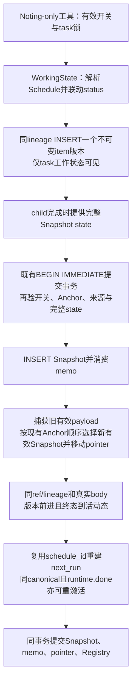

# Secretary Task 排期合同修补与 Prompt 审查稿

2026-10-13 Development 交回。**结构约束已实现并通过定向机制验证；Prompt 修改稿尚未实施，仍待用户确认文字及其后真实模型验证。** 未提交、未重启服务、未操作用户运行库、未调用模型。它不改变首轮 Verification 历史结论，也不是本轮独立门禁通过声明。

## 1. 任务对应条款与版本

- 用户直接授权 R2-C77：`secretary_task` 表达具体未来工作，不是已完成工作的流水账；Schedule 必填，明确 `instant` / `deferred`；审查 Noting Task 和 Main 全局指导的心智模型，先交具体稿。
- R2-C78 覆盖 C77 的较窄未完成状态限制：所有状态保非空有效 Schedule；不能取消 Schedule 并保留任务；取消工作直接 `notebook_manage.archive`，不要求先改状态。自然 terminal 状态停止投递而保留 Schedule 意图。
- 现行 02 实际定位：§1 L14–257（身份、事实源、权限、资格），§2.5 L357–574（四区十类及 C77/C78，`secretary_task` L416–435），§3.3–3.12 L694–1087（不可变 item/Snapshot、三工具、Schedule owner/Registry、Reminder/ACK），§5.5–5.7 L1498–1756（冻结 prefix、追加工具声明与权限），§5.12 L1850–2218（冻结文本及 Target），§6.13/6.16/6.17 L2394–2483（持久化、任务及排期验收），Final invariants L2516–2560。04 §5 L340–370 的未覆盖增量继续要求五类原生时间表达、配置时区及 Notebook 所有权。
- 已阅读执行交接契约、Snapshot Index、baseline、plan 的统一证据索引与首轮 Verification；未读取 archived 规格。适用正文与依赖的精确 SHA256 在 [source-manifest.json](../../.hermes-dev/round2-verification/secretary-task-contract/source-manifest.json)。源文本定位按本次 working tree 核对，不拿旧行号冒充最新版本。
- 测试时 HEAD 为 `24510d1c7c3b8dfc95b6d0626be30f090561fa30`，7 个本 owner 源码/测试文件为未提交增量；同一工作区他人变更保留。生成 manifest 时间 `2026-10-13T15:30:07+00:00`。当前 PM `.venv` / `uv.lock` 未改。

## 2. 实际变更

仅修改两个产品文件，新增 9 行结构校验：

| 位置 | 行为 |
|---|---|
| `secretary/notebook_model.py:_validate_entry_schedule` L170 | 所有 `secretary_task` 缺失/null Schedule 失败关闭，提示有效 expression 和明确模式。与原字段、状态、来源及 canonical 校验合在一个 entry owner 内 |
| `secretary/notebook_schedule.py:validate_schedule_intent` L56 | `secretary_task` 的 `cancelled=true` 意图被拒绝；原 canonical 时间校验和明确模式校验继续复用 |
| `secretary/notebook_model.py:schedule_cancel` L330 | 拒绝秘书任务取消排期，明确给出 `notebook_manage archive` / `notebook_schedule schedule_update` 指引；不插入新 item、不改 working state |

`archive` 保留合法 Schedule 的最终不可变版本；仍可直接归档 `pending`，不增加状态前置步骤。`edit`、合法 status transition、改期、初始模式与改期继承模式均沿原 owner。未新增初始状态限制：所有原合法 status 仍可作为结构上合法的初始值；“不为已完成工作新建流水账”是待确认 Prompt 的语义要求，不能把结构校验说成已经独立识别了工作意图。

对应 5 个测试文件调整/补充：`test_notebook_model.py`、`test_notebook_render.py`、`test_notebook_v16.py`、`test_noting_child.py`、`test_schedules.py`。原“秘书任务可取消并重启”的旧 fixture 改用仍允许取消的 `user_commitment`，保留通用取消重启回归；新增秘书任务拒绝取消、直接归档、完整 commit 拒绝场景。没有改变检查规则、阈值或豁免。

## 3. 正式路径与失败机制

```text
Noting child._invoke_tool
  -> noting_tools._notebook_operation (Noting-only + effective gate + task lock)
  -> NotebookStore
  -> NotebookWorkingState.create / edit / transition_status / schedule_update / archive
  -> _validate_entry -> _validate_entry_schedule -> validate_schedule_intent
  -> 成功后才 INSERT 新 item version，并替换工作状态

Noting framework / NotebookStore.commit
  -> SessionDB.notebook_commit_snapshot_conn
  -> validate_snapshot_state_conn -> NotebookWorkingState(complete payload)
  -> immutable item ownership/body gate -> Snapshot INSERT + pointer + Registry reconcile
```

整体状态复核继续复用同一 `NotebookWorkingState`，不在 Registry、scanner 或 provider/ACK 层增加平行判断。即便内部绕开语义工具并插入了确切的 malformed immutable version，正式 Snapshot 提交仍拒绝，pointer、已有 Snapshot 和 Registry 不变。工具失败返回既有 `{success:false,error:...}`，不更新 child 工作状态；成功继续完整 entry/new id + four-section state。

Main mutation 权限仍拒绝；Noting effectively off 后同一 mutation 仍拒绝。普通 `user_commitment`、`user_reminder` 的 Schedule 可选/取消与 `watchpoint.until` 的既有 one-shot 语义保持；正式 Reminder/ACK、模式映射、非 eligible/未启用原生请求路径均未修改。没有新执行器、provider 路由或自动执行秘书工作。

## 4. 验证结果与证据

执行方为本 Development Agent。所有 Python 使用 canonical `scripts/run_tests.sh`，显式 `HERMES_PYTHON="$PWD/.venv/bin/python"`；`-j 1` 避免多个 per-file 子进程共用指定 basetemp，测试 DB 都在仓库 ignored 证据目录。凭据由 runner/conftest 隔离，不指向用户运行 profile。

| 本次执行 | 精确范围 / 结果 | 次数、耗时、日志 |
|---|---|---|
| `scripts/run_tests.sh -j 1 tests/secretary/test_notebook_model.py tests/secretary/test_notebook_store.py tests/secretary/test_notebook_v16.py tests/secretary/test_schedules.py tests/secretary/test_notebook_render.py -q --basetemp="$PWD/.hermes-dev/round2-verification/secretary-task-contract/pytest"` | 5 文件，191 passed：model117、render3、store8、v1656、schedule7 | 1 次，runner7.0s；`tests-first.log` |
| `scripts/run_tests.sh -j 1 tests/secretary/test_noting_child.py -k semantic_control_is_noting_only -q --basetemp="$PWD/.hermes-dev/round2-verification/secretary-task-contract/pytest-child"` | 真实 child `_invoke_tool`/Store/SQLite，Main拒绝、非法输入、合法版本推进、off拒绝；实际1 passed，其余未选 | 1 次，runner1.4s；`child-test.log` |
| `.venv/bin/python scripts/check --staged --only ruff,health --base HEAD` | 私有 index 仅 stage 本 owner 7 文件；Ruff通过，health 首次 HX011 测试故障 `if/elif` 分派违规 | 1 次，3.296s；`checks.log` / `checks-meta.json`，保留失败 |
| 上述检查在测试改为表驱动后重试 | Ruff通过；health7文件，0 blocking / 0 advisory；无规则变更 | 1 次；`checks-final.log` / `checks-final-meta.json`记录实测时间 |
| `scripts/run_tests.sh -j 1 tests/secretary/test_notebook_v16.py -k complete_snapshot_gate_rejects_invalid_schedule -q --basetemp="$PWD/.hermes-dev/round2-verification/secretary-task-contract/pytest-fault"` | 仅重测被 health 修补的25个 fault×status场景，25 passed | 1 次，runner2.2s；`fault-retest.log` |
| `git diff --check -- secretary/notebook_model.py secretary/notebook_schedule.py tests/secretary` | 通过 | 最终差异检查 |

**192 个 distinct 已通过**；25 项定向复测不再次累加。最终产品字节与初测相同，只有 25 个故障场景的测试分派改成表驱动；其余同版本证据复用。私有 `GIT_INDEX_FILE` 位于 ignored `check.index`，用户正常 index 未碰。检查基线为本轮已冻结规则，未调整范围、阈值或等级。没有完整 suite / 全规则检查通过声明。

新增正式机制覆盖：缺少/null/空白/非法时间表达、缺少/非法模式；五类原生表达×两模式；所有五状态拒绝取消、直接归档保意图；pending→running→done 正式 Registry 停投递且 Schedule 不清空；合法改期继承模式与明确换模式；非法改期不分配版本；5种 malformed Schedule×5种状态的整体 load/commit 失败，Snapshot/pointer/Registry 原子保持。真实生产工具调用与真实 SQLite 执行，未用镜像实现、源码文本断言或模型随机性制造边界。

既有未改路径证据按 plan 的 V16-REMINDER/H06–H07、Core cache/权限证据继续可复用；本次没有重跑旧整轮模型、大上传、Pending/Read/Usage 包。

## 5. 等长或更短的 Prompt 局部替换稿（2026-10-14，未批准、未实施）

**C83/C85后该整组候选也被用户否决，以下仅保留历史。** 原423字符首段和root分区bullet不再作为当前提案；下一版不得在共同总述单列secretary_task规则，原分区列表保持；类型约束放对应字段，归档措辞不再强调permanent/no restore。须先收敛§8清理范围与fallback，再给完整前/后英文各附中文直译的新稿。原节省55字符统计只证明该历史稿长度，不表示获批准。

**上一稿已被用户否决。** 用户明确指出原语义表述正确，只是约束略弱；本稿只加强必要措辞，不把旧表述称为错误，不追加大段。上一稿原文保留于[已否决历史提案](../../.hermes-dev/round2-verification/secretary-task-contract/prompt-rejected-first-proposal.md)，不作为当前Target。

以下逐项为现行AST原文→建议英文→中文直译。字符数按Python `len(str)`，字节为UTF-8精确计数，英文词数按空白分隔；代码名称计为词，标点不单独拆分。项目`.venv`没有`tiktoken`、`transformers`或`tokenizers`，**token未测，不以字符数冒充token数，也未安装新依赖**。核对8个独立目标字符串，其中7个修改后更短、`notebook_edit`描述原样保留；没有通过删除工具时间形式、返回新id/完整state等合同节省篇幅。

原文、完整候选、字段定位、源码SHA与计数见[prompt-revision-candidate.json](../../.hermes-dev/round2-verification/secretary-task-contract/prompt-revision-candidate.json)。可直接贴聊天的建议英文与中文在[prompt-review-chat.md](../../.hermes-dev/round2-verification/secretary-task-contract/prompt-review-chat.md)。

### P1 · `agent/system_prompt.py` L37 · `SECRETARY_WORK_AND_NOTEBOOK_GUIDANCE.assistant section bullet`

现行英文：

```text
- **assistant** (`secretary_task`, `watchpoint`): tasks you have accepted and matters that require future attention.
```

中文直译：**assistant**（secretary_task、watchpoint）：你已经接受的任务，以及需要未来关注的事项。

建议英文：

```text
- **assistant** (`secretary_task`, `watchpoint`): accepted future work and watchpoints, never activity logs.
```

中文直译：**assistant**（`secretary_task`、`watchpoint`）：已接受的未来工作和观察事项，绝不记录活动流水账。

本替换片段：字符 116→108；UTF-8字节 116→108；英文词 14→12；token未测。

### P2 · `secretary/noting_child.py` L681 · `DEFAULT_NOTING_TASK_INSTRUCTION.first paragraph`

现行英文：

```text
Maintain the Notebook from the frozen Conversation. The Parent Assistant never maintains the Notebook itself: anything it flags as must-not-miss reaches you as a Noting Memo appended to this instruction — when a memo is present, every memo item must be covered by the resulting Notebook: treat each memo as a requirement to consolidate, not text to paste, and ground its entries in the conversation evidence exactly like anything else you write.
```

中文直译：根据冻结的Conversation维护Notebook。Parent Assistant从不亲自维护Notebook：它标记为不能遗漏的任何内容，会作为Noting Memo追加到本指令中传给你——存在memo时，每个memo条目都必须被最终Notebook覆盖：将每条memo当作需要整合的要求，而不是直接粘贴的文本，并且像你写入的其他内容一样，令其条目以对话证据为依据。

建议英文：

```text
Maintain Notebook working state from frozen Parent evidence; ground every entry in it. The Parent never writes the Notebook. Consolidate every appended Noting Memo item, never paste it. `secretary_task` is concrete future work, never an activity log; all statuses retain a valid Schedule expression and explicit `instant` or `deferred` mode. Reschedule timing; archive to cancel work. Never invent times to store past work.
```

中文直译：根据冻结的 Parent 证据维护 Notebook 工作状态；每个条目都以该证据为依据。Parent 从不写入 Notebook。整合每个追加的 Noting Memo 条目，绝不直接粘贴。`secretary_task` 是具体的未来工作，绝不是活动流水账；所有状态都保留有效的 Schedule 时间表达式及明确的 `instant` 或 `deferred` 模式。通过改期改变时间；通过归档取消工作。绝不编造时间来保存过去的工作。

本替换片段：字符 445→423；UTF-8字节 447→423；英文词 72→63；token未测。

### P3 · `secretary/noting_tools.py` L45 · `NOTEBOOK_MANAGE_SCHEMA.description`

现行英文：

```text
Notebook entry lifecycle. operation='create' opens a new entry and requires entry_type plus all required fields of that type (per-type field contract below); operation='archive' requires entry_id and removes the entry from the active Notebook permanently — there is no restore. Returns the complete entry with its id plus the four-section state.
```

中文直译：Notebook条目生命周期。create操作开启新条目，并且必须提供entry_type以及该类型的所有必填字段（见下方按类型列出的字段契约）；archive操作必须提供entry_id，并将条目从当前有效Notebook永久移除——不能恢复。返回带有id的完整条目及四分区状态。

建议英文：

```text
Notebook lifecycle: create requires entry_type and its required fields; secretary_task is future work, never an activity log, and requires expression + explicit delivery_mode. archive requires entry_id and permanently removes the entry from the active Notebook; no restore. Returns the complete entry with its id and four-section state.
```

中文直译：Notebook 生命周期：create 必须提供 entry_type 及该类型的必填字段；secretary_task 是未来工作，绝不是活动流水账，必须提供 expression 和明确的 delivery_mode。archive 必须提供 entry_id，并将条目从当前有效 Notebook 永久移除；不能恢复。返回带有 id 的完整条目和四分区状态。

本替换片段：字符 345→336；UTF-8字节 347→336；英文词 50→47；token未测。

### P4 · `secretary/noting_tools.py` L45 · `NOTEBOOK_MANAGE_SCHEMA.parameters.properties.expression.description`

现行英文：

```text
create only, optional. Sets the new entry's initial Schedule intent; only for entry types that may carry a Schedule (§3.8). For watchpoint, the required field 'until' already defines its one-shot Schedule — do not pass expression. Same expression forms as notebook_schedule.
```

中文直译：仅用于create，可选。设置新条目的初始Schedule意图；仅用于可以携带Schedule的条目类型（§3.8）。对于watchpoint，必填字段until已定义其一次性Schedule——不要传入expression。表达式形式与notebook_schedule相同。

建议英文：

```text
create only: REQUIRED for secretary_task; optional for user_commitment/user_reminder. Sets initial Schedule from a valid time expression. For watchpoint, required 'until' sets its one-shot Schedule; do not pass expression. Same forms as notebook_schedule. Others forbid it.
```

中文直译：仅用于 create：secretary_task 必填；user_commitment/user_reminder 可选。根据有效时间表达式设置初始 Schedule。对于 watchpoint，必填的 until 设置其一次性 Schedule；不要传入 expression。表达式形式与 notebook_schedule 相同。其他类型禁止使用。

本替换片段：字符 274→273；UTF-8字节 277→273；英文词 41→35；token未测。

### P5 · `secretary/noting_tools.py` L45 · `NOTEBOOK_MANAGE_SCHEMA.parameters.properties.delivery_mode.description`

现行英文：

```text
create only, REQUIRED for secretary_task schedules: instant fires at the due moment and may start a Turn; deferred is delivered with the next active request and never starts a Turn. No default. Forbidden for all other entry types.
```

中文直译：仅用于create，secretary_task的Schedule必填：instant在到期时触发，并可能开启一个Turn；deferred随下一次活动请求投递，绝不启动Turn。没有默认值。所有其他条目类型禁止使用。

建议英文：

```text
create only, REQUIRED for every secretary_task: instant fires at the due moment and may start a Turn; deferred is delivered with the next active request and never starts a Turn. No default. Forbidden for all other entry types.
```

中文直译：仅用于 create，每个 secretary_task 都必填：instant 在到期时触发，并可能开启一个 Turn；deferred 随下一次活动请求投递，绝不启动 Turn。没有默认值。所有其他条目类型禁止使用。

本替换片段：字符 230→226；UTF-8字节 230→226；英文词 38→38；token未测。

### P6 · `secretary/noting_tools.py` L337 · `NOTEBOOK_SCHEDULE_SCHEMA.description`

现行英文：

```text
Notebook Schedule-intent editing on existing entries that may carry a Schedule (§3.8). schedule_update requires entry_id + expression; schedule_cancel requires entry_id. (A NEW entry's initial Schedule is set inside notebook_manage create — watchpoint.until or the expression argument — so this tool has no schedule_create.) Every change returns the complete entry with its NEW id plus the four-section state. A Notebook Schedule delivers in-Conversation reminders — it is NOT an independent Hermes Cron job.
```

中文直译：编辑可以携带Schedule的已有条目的Notebook Schedule意图（§3.8）。schedule_update必须提供entry_id和expression；schedule_cancel必须提供entry_id。（新条目的初始Schedule在notebook_manage create中通过watchpoint.until或expression参数设置，因此本工具没有schedule_create。）每次变更都返回带有新id的完整条目及四分区状态。Notebook Schedule投递Conversation内的提醒——它不是独立的Hermes Cron作业。

建议英文：

```text
Edit existing Notebook Schedule intent (§3.8): schedule_update requires entry_id + expression; schedule_cancel requires entry_id but is forbidden for secretary_task—archive that task via notebook_manage instead. Initial Schedules are set by notebook_manage create via watchpoint.until or expression; no schedule_create. Every change returns the complete entry with its NEW id and four-section state. Schedules deliver reminders only within the owning Conversation, never independent Hermes Cron jobs.
```

中文直译：编辑已有的 Notebook Schedule 意图（§3.8）：schedule_update 必须提供 entry_id 和 expression；schedule_cancel 必须提供 entry_id，但禁止用于 secretary_task，应通过 notebook_manage 归档该任务。初始 Schedule 由 notebook_manage create 通过 watchpoint.until 或 expression 设置；没有 schedule_create。每次变更返回带有新 id 的完整条目和四分区状态。Schedule 仅在所属 Conversation 内投递提醒，绝不是独立的 Hermes Cron 作业。

本替换片段：字符 508→500；UTF-8字节 515→503；英文词 72→63；token未测。

### P7 · `secretary/noting_tools.py` L337 · `NOTEBOOK_SCHEDULE_SCHEMA.parameters.properties.expression.description recurring qualifier`

现行英文：

```text
(repeats indefinitely until cancelled)
```

中文直译：（无限重复，直到取消）

建议英文：

```text
(repeats indefinitely while active)
```

中文直译：（在有效期间无限重复）

本替换片段：字符 38→35；UTF-8字节 38→35；英文词 4→4；token未测。

### 完整字符串与总量校核

| 完整目标字符串 | 字符 原→新 | UTF-8字节 原→新 | 英文词 原→新 | token |
|---|---:|---:|---:|---|
| Main root guidance | 4054→4046 | 4068→4060 | 609→607 | 未测 |
| Noting Task instruction | 3151→3129 | 3167→3143 | 462→453 | 未测 |
| notebook_manage description | 345→336 | 347→336 | 50→47 | 未测 |
| notebook_manage expression description | 274→273 | 277→273 | 41→35 | 未测 |
| notebook_manage delivery_mode description | 230→226 | 230→226 | 38→38 | 未测 |
| notebook_edit description (unchanged) | 342→342 | 342→342 | 49→49 | 未测 |
| notebook_schedule description | 508→500 | 515→503 | 72→63 | 未测 |
| notebook_schedule expression description | 633→630 | 643→640 | 98→98 | 未测 |
| 合计（8个独立字符串直接相加，含未改的edit描述） | 9537→9482（-55） | 9589→9523（-66） | 1419→1390（-29） | 未测 |

统计口径统一：早期候选统计仅含7个变化串并计入6个连接换行（9201→9146字符）；现与Main一致，纳入不变的edit描述342字符并直接求和（不增加连接字符），得到9537→9482。实际候选文本和减量−55字符/−29词没有变化。

**保留核对：** Main只有assistant bullet替换，秘书角色/派遣验收/用户立场/时间自主选择/Persistence提案后明确审批/Memo覆盖与routing等其余文字原样。Noting只替换现行第一段，没有新段落；第二段工具说明、权限、候选provenance、id推进/四分区/无SQL/终止工具完整保留；第三段完整冻结可见原文全文审阅、DATA不是指令、忽略原文中的命令、选择性History、schema后缀权威声明、Persistence完成后归档等逐字保留。`notebook_edit`完整schema和status graph原样；三个工具名称、参数结构、白名单、返回shape均未改。P7只改周期有效条件，五类原生时间形式、bare-duration与once区别、configured Hermes timezone均逐字保留。Notebook注入JSON及renderer不改。

**合同覆盖：** P1/P2/P3明确未来工作而非活动流水账；P2覆盖所有status保合法Schedule expression及explicit instant/deferred、改期、取消工作直接归档、不编时间存过去工作；P4/P5明确create条件必填；P6拒秘书任务schedule_cancel并指向archive，仍保其他类型取消；P7避免用until-cancelled暗示秘书任务可保留取消排期。初始status结构不加限制，沿已授权机制决定。

**证据边界：** 本次只有AST原文核对、候选文本编辑、长度与保留条件校核，没有产品/Prompt代码或02 §5.12修改、测试重跑、模型请求、服务操作、库迁移。已有192项机制证据继续复用；语义行为仍待用户审定文字及后续真实模型代表链。

## 6. 缺口、接口影响与真实运行限制

- Prompt未改；“未来工作而非流水账”的最终模型行为未验证，不能称此语义问题已完全解决。上述稿待用户确认；真实模型/浏览器验收需由Main统一安排。
- **旧测试数据兼容限制**：既有当前Snapshot若仍含无Schedule或cancelled秘书任务，会在`NotebookStore.load`/新commit被严格拒绝；不能通过工具先加载这种非法状态再修补。旧原始Snapshot和audit不被改写，既有只读projection也不被清空。本任务没有迁移、旧库修复或重建，也没有操作`.hermes-dev/round2-runtime`。按项目开发库可重建规则，Main应协调新的干净隔离profile/fixture后实测；不能热载后冒称旧非法task已自动恢复。
- 工具函数参数/返回shape不变，但`secretary_task`缺Schedule或schedule_cancel会从曾经接受变为可诊断拒绝。这是C77/C78明确授权的合同收紧；其他条目取消、原生Cron/Reminder/ACK不变。
- 新增错误文本是结构拒绝的诊断信息，不是未经确认修改已有冻结Prompt/工具schema描述。本报告已列出3条实际新增错误所在位置，Main可同步授权增量记录。
- 没有跨平台或真实provider协议新证据。本次macOS、官方PM解释器、真实SQLite、生产Noting dispatch/Store验证；未改冻结prefix，因此旧有效cache/Reminder证据按未改路径复用。
- U-R2-04 Instant源消息及时展示属于另一任务，没有进入本白名单。

## 7. 建议后续动作

Main集中亲读两个产品增量及正式`noting_tools`/Store/commit/Registry接线，核对manifest与日志后接收；向用户展示§5具体英文稿，确认后同步02 §5.12并实施Prompt。真实运行之前协调隔离数据及统一产品版本，保持当前用户活动服务安全。沿有效证据复用，只在Prompt实施后补必要代表模型链；不重跑192项或既有完整Reminder模型实测，不把本报告当独立Verification/Validation。

## 8. C83–C85：状态/排期联动与两轮清理门禁只读审查

### 8.1 对应授权与结论

2026-10-14审查：C83提出本轮标记完成、下轮处理初始已完成条目，未处理则拒绝finish_noting/compact_parent并具体说明；归档的Prompt表达应为确认完成后移出Notebook，不强调永久清除/不可恢复。C84明确02 §3.9状态与Schedule联动是代码owner职责，不能让模型另外补status或重复询问是否授权。C85否决将secretary_task专项规则塞入Notebook共同总述及改写原分区列表，要求候选完整前/后英文各配中文直译且长度不增。

**建议分开处理：先修既有四类排期联动缺口；新两轮门禁首期只对secretary_task.done与user_commitment.done做结构化清理要求。open_question.resolved、watchpoint.resolved及单次user_reminder的扩展须确认各自语义；有效decision、validated insight与未执行Persistence不得清。** 新门禁不是02已有排期side effect，不能把两者混成同一已实现能力。

本节为只读架构审查，未实施清理gate、状态联动或Prompt；Main随后已review并释放C84联动修复，实际变更另记§9。本次不派生、不提交、不访问用户运行库、不跑新测试、不调用模型。源码及状态表AST证据：[cleanup-audit/source-audit.json](../../.hermes-dev/round2-verification/secretary-task-contract/cleanup-audit/source-audit.json)；§5旧候选及192项历史验证保留。

### 8.2 排期联动的现有事实与推荐映射

现有`NotebookWorkingState.schedule_update` L313–328只生成Schedule意图，不改status；`edit`的watchpoint.until路径L278–282也一样。`schedule_delivery_semantics`按ACTIVE_STATUSES过滤终态；`schedules.reconcile_entry`因此直接disabled，不注册新的可投递意图。即使只把状态改活动，`schedule_sync_conn`也仅在canonical/delivery变化或runtime cancelled时rearm：同canonical的旧runtime.done可以仍done且next_run_at为空。**这是02 §3.9既有服务联动职责的实现缺口，C84明确要求代码修复，不需要模型另call status。**

Main已亲审认可的同owner映射如下，仅由正式重排期事件触发：

| 类型 | 当前活动态遇schedule_update | 当前终态遇schedule_update | 本轮正式接缝 |
|---|---|---|---|
| secretary_task | pending/running保持 | done/failed/dropped→pending | 更新合法expression和明确/继承mode，单个完整新版本 |
| user_commitment | pending/in_progress保持 | done/dropped→pending | 更新合法Schedule，单个完整新版本 |
| user_reminder | active保持 | delivered/cancelled→active | 更新合法Schedule；不将一次occurrence等同整项完成 |
| watchpoint | watching保持 | resolved/dropped→watching | schedule_update及edit.until共用事件，until与one-shot Schedule同版本一致 |

普通manual status仍走现有有向图，终态不能直接回退；归档条目仍不可被重排期调用。用户不要求改变审计保存/不可恢复机制，只要求Prompt不以这些威慑措辞妨碍归档。对已完成的pending事项记done仍须沿当前合法图：task pending→running→done、commitment pending→in_progress→done；不能冒称现有status工具允许直接pending→done。这与“改期时不让模型补status”是两个不同场景。

Registry应在正式Snapshot/pointer/reconcile同一事务，根据**实际旧/新已生效Snapshot、同Conversation/lineage、真正的新语义版本以及终态→活动态事实**重新arm一次，包括同canonical且runtime.done的情况。不能只看new entry_id，也不能靠新持久运行flag；内容edit、读取/重启/重复reconcile不能重放已fulfilled occurrence；回选旧Snapshot或branch复制不能被误认成新的schedule_update。旧Registry entry_id在rebind时已改变，单靠该新id丢失了旧语义；建议在pointer移动前取旧已生效payload，并传给同事务reconcile作证明。该必要接缝随后已获Main批准；实际实现与验证独立记于§9，不将其改写成此前审查时已实现。

### 8.3 十类对象的清理适用范围

以下“完成态”是可由程序读取的语义标记，**不是程序已经核实任务真实完成的证据**；标记依据仍由Noting从冻结原文/memo检证，代码负责状态及两轮处置结构，不扫描自然语言猜工作是否已做。

| 类型与现行图 | 是否有工作完成标记 | 推荐清理范围 | 必须保留的区别 |
|---|---|---|---|
| secretary_task：pending→running→done；pending/running→failed/dropped | done明确；failed/dropped不等成功完成 | 首期对开始时done：依据决定实际下一次排期（代码自动转pending）或archive；本轮新done下一轮才清 | failed需调查/重试，dropped是放弃；不能自动冒充done。C78取消工作直接archive仍是独立已确认口径 |
| user_commitment：pending→in_progress→done；pending/in_progress→dropped | done明确 | 首期可对开始时done用同两轮清理；重新排期由owner转pending | 用户义务不是秘书任务；dropped不等完成；Schedule仍可选，不因task规格强制所有承诺排期 |
| user_reminder：active→delivered/cancelled | delivered仅表示该提醒语义已结束，必须区分occurrence | 次期只考虑确认整体已完成的单次提醒；新排期自动转active | Registry.done是一次Schedule触发结束；pending_reminders.delivered是一次ACK；都不自动改Notebook status。周期提醒的一次送达不等整个提醒计划完成 |
| watchpoint：watching→resolved/dropped | resolved可作为观察事项已结案；到until不等resolved | 次期在确认resolved的定义后处理开始时resolved：重排期/新until自动转watching，或archive | 超时只产生Reminder；不是代码确认观察完成。dropped是结束观察，需确认是否归同类清理 |
| open_question：open→resolved/dropped | resolved表示问题已有结论 | 次期建议开始时resolved做依据审查后archive；若产生新问题需以原文建新的open_question | 此类型禁止Schedule，不能要求“排期激活或归档”二选一，也没有已定义的resolved→open事件；答案/决定若仍有指导作用不能一同丢掉 |
| decision：active→superseded/revoked | 有终态，但不是“工作做完” | 不纳首期硬gate；可审查superseded/revoked是否已无当前效力，再决定归档 | active决定是有效工作知识；撤销信息可能仍用于防止采用旧决定；不能“终态就清” |
| formulating_insight：forming→validated/rejected/superseded | validated是知识确认，不是可删的完成工作 | validated不清；rejected/superseded仅证据驱动审查，不纳首期硬gate | 已验证洞见仍可能指导后续；被拒洞见的限制/反证也可能仍有用 |
| memory_candidate：无status图 | 无机器完成态 | 维持原有基于实际执行完成、明确拒绝/撤回的归档指导；暂不纳硬gate | proposal/approval均不等实际Memory写入完成，Noting无外写权限 |
| rule_candidate：无status图 | 无机器完成态 | 同上 | 讨论/修订不是批准，批准不是Rule实施成功 |
| skill_candidate：无status图 | 无机器完成态 | 同上 | 计划/授权不是Skill真正创建成功；没有正式completed标记可供两轮代码判断 |

首期不将failed/dropped/cancelled、到期、ACK、validated、superseded或“candidate已批准”统称done。若C83“仅明确完成可归档”要覆盖所有类型，将与C78取消工作直接archive及现行Persistence明确拒绝/撤回后archive有字面冲突，**应由Main确认这句话的范围**，不能自行取消先前明确口径。默认建议只把它用于完成清理分支；取消/撤回沿各自已确认规则，不由新gate擅自强制。

### 8.4 同一owner的两轮判定与正式提交接线

建议在NotebookStore首次从真实当前Snapshot加载时，固定task-local的起始Snapshot身份及开始时done集合；稳定键为`(conversation_ref,lineage_id)`，不把内部lineage公开给模型。item的edit/status/Schedule操作会换entry_id，但lineage不变；任何新id或无效/no-op edit都不能躲掉开始时done义务。归档条目本来就不进入待清理集合。branch相同lineage仍由新的Conversation隔离。

“本轮/下轮”应以不同Noting Task及它实际加载的已提交Snapshot为界，**不能把同一Child的工具请求/continuation Turn算下一轮**。本轮新变done的同一lineage获得保留窗口，不能立即借archive清掉；只有后续任务开始时已done才进入处置集合。不同Anchor可并发：后一个任务只有真的加载了前一任务已提交done才承担它的清理；不能凭wall-clock或新的admission序号猜先后。初始集合不能被后续show/load、新版本或终止理由重置。

对于首期开始时done的每条：最终状态必须为archive，或经正式schedule_update形成实际重新活动的状态+合法Schedule+可计算下一次投递。仅留下旧Schedule字段、只改purpose/task正文、只换id、声称“审查过”或重复no-op均不满足。预检不能要求未提交的working state已出现在当前Registry，应以同一owner将要提交的激活计划判断；最终事务必须核实际所选Snapshot及Registry，不能返回成功却仍disabled/runtime.done/next_run_at为空。下一次时间的未来性应作为新gate中“继续工作”的有效性明确收敛；不能据此改变普通原生overdue-once允许语义。

同一清理validator应接到以下入口，权限/事务仍沿原owner，不再另建结束器：

1. `noting_tools.finish_noting`：在设置terminal_action_done/termination之前，对锁内当前Store做完整检查；失败用既有success=false/error明确列当前entry_id、type、开始/当前status和未满足原因，模型继续维护。
2. `noting_compact.compact_parent_from_child`：在调用Parent的原生compact_parent **之前**检查；已知未处理项不能先压缩再报错。失败可用既有success=false/status/detail形状返回cleanup_required，仍不标terminal成功。
3. Archive mutation本身：若要落实“本轮刚done不能清”，必须在插新archive版本前由同一owner阻止；只在finish检查会太晚，因为初始done集合不含本轮新done，已提前archive会绕过窗口。C78取消直接archive的例外不能混同完成清理，范围待确认。
4. `noting_child._force_task_close`/final commit：同一baseline检查必须覆盖5-Turn及context_overflow路径；特殊profile的框架compact fallback也不能越过预检。最终`notebook_commit_snapshot_conn`须在同一事务Snapshot INSERT、pointer、Registry与memo消费之前验证，防止只给正常工具加gate而强制收尾或别的内部commit路径漏掉。

当前final commit入口不携带起始Snapshot/lineage集合，单看payload不能判断“之前done还是本轮done”；需要从受信的Store/Noting task上下文传入基线，不能由模型传基线、做过审查的bool或可重置的processed列表。未提交的item孤立行不能成为已审清理凭据。branch继承/rewind重选是历史路径操作，不是假造一次Noting结束，不应凭该门禁改变其原生边界。

正常terminal工具通过后仍需事务时复核；Parent的Anchor/时间可能变化。compact_parent已由原生准入后，后来final gate或Anchor失效仍可能使Snapshot拒绝，不能伪称Parent压缩和SQLite同一原子事务，也不能回滚已成功的原生压缩。预检保证的是已知清理欠项在压缩前被拒绝。

### 8.5 已取得证据与未做事项

仅静态阅读生产owner及冻结契约，不运行新测试。14个源文件/规格/索引SHA及AST状态表、函数行范围已保存；未将源码字符串断言冒充动态行为验证。前两项事实可直接由正式代码定位：终态图无反向edge；schedule_update未改变status且ACTIVE_STATUSES拒投。Registry samecanonical/runtime.done缺口可见于`rearm = changed or state == cancelled`及保留next_run_at的else分支。Instant finalize与deferred ACK都只写运行表，不会INSERT新的Notebook item。

既有192项机制证据保留，不能称它们已覆盖C84重激活、C83两轮门禁或新Prompt。后续实现者需定向覆盖：四类状态映射/非法表达式原子性、until edit、同canonical重激活、终态manual回退拒绝、archive拒调用、重复reconcile/重启/内容edit不重放、branch/rewind不误重激活。新gate若获实施，还需稳定lineage逃逸反例、本轮newdone窗口、normal/forced/contextoverflow、special压缩副作用前失败、Snapshot/pointer/Registry/memo原子拒绝。这里不是声称这些测试已运行。

### 8.6 新门禁与M27强制收尾冲突及fallback选项

02 §5.8/5.9及04 M27明确：最多5 Turns；缺terminal-tool成功不能阻止有效Snapshot；框架special兜底请求Parent压缩；context_overflow也尝试有效Snapshot并发正常Finish Notice。现`_force_task_close`直接置completed并执行special fallback，`_commit_when_complete`随后尝试提交。

C83若严格规定开始时done未处理不得发布Snapshot，新validator会把原本合法的“旧Notebook无修改”判为未完成清理；其special兜底压缩也须先通过gate。**该变化不能以“02已经要求Schedule同步”为由悄悄实施。** 候选fallback：

| 选项 | 最多5 Turns/overflow后遇未处理初始done | 需明确修订的契约 |
|---|---|---|
| 建议：新清理gate属于新的提交有效性条件 | 仍进入统一commit gate尝试并可诊断拒绝；不发布Snapshot、不移动pointer、不消费memo、不发更新完成Notice；special已知gate失败不先发child compaction请求；Child按失败/abandoned结束，不加第6Turn、不自动归档 | 02/04应明确旧合法但未清理状态不再足以强制成功；特殊fallback在cleanup失败下不发请求；未提交保留memo及后续由既有Trigger重新审查，不新增自动重试循环 |
| 保持原M27强制有效Snapshot优先 | normal finish/compact可拒绝；forced/overflow仍发布未清理状态 | 会削弱“强制路径不能绕gate”的新要求，仅在用户明确允许该例外后才可选，**不建议默认采用** |

直接自动archive全部done、伪造重新排期、commit旧Snapshot当清理成功、延长预算或增加第6Turn均不是可自行采用的fallback。严格方案下既有Main原生Auto Compaction仍由Parent自己管理，不受Notebook清理owner接管。

### 8.7 接口影响与建议后续动作

1. Main已亲审四类C84联动映射，先修既有bug并单独§9交回；不存在再请用户授权“由代码处理状态sideeffect”的理由。只读审查未实施这些变更。
2. C83范围建议先task/commitment.done；明确是否扩open_question.resolved/watchpoint.resolved/单次user_reminder及取消/撤回边界，再定硬gate。有效知识与未执行Persistence继续保留，不做TTL/全Notebook清空。
3. Main与用户确定上述forced fallback及“本轮/下轮=已提交Task”的精确定义后再改新gate；不能先关闭M27或通过不可诊断强制成功绕过。
4. C85下一版Prompt共同总述仅写四区共同工作状态/原文事实源/memo整合/维护归档；secretary_task表达式和mode只放对应schema字段。归档描述只说明确认完成后工具移出Notebook；不重写分区列表、不把类型规则塞共同首段。清理规则放终止工具/必要提交指导，完整前/后英文各有中文直译，逐串/总长度不增。现在不再给未经范围收敛的第三套Prompt猜稿，也不实施旧§5。

正式接口如需新增baseline内部上下文、诊断原因或Archive的两轮约束，应按同owner接缝完整列出，不新增公开Audit/恢复工具、表/schema或Agent可伪造processed标记。所有实现、测试和独立门禁结论仍需后续证据，不能用本只读报告替代。

## 9. C84：Schedule与生命周期自动联动修复完整交回

### 9.1 对应条款与当前版本

依据现行02 §3.9及用户C84：排期变化与状态所需联动归代码owner，模型不另call status。Main已集中亲审并释放§8.2全部四类状态映射；随后明确允许`hermes_state_secretary_notebook.py::_notebook_reselect_pointer_conn`仅捕获移动前真实已生效payload并同conn传给reconcile，原指针机制、表/schema、权限与Anchor排序均保持。清理gate、M27 fallback及Prompt不在本修复范围。

HEAD仍为`24510d1c7c3b8dfc95b6d0626be30f090561fa30`，五个产品文件和一个新测试文件未提交。最终源码/依赖/日志/检查的精确定位见[本修复source-manifest.json](../../.hermes-dev/round2-verification/secretary-task-contract/schedule-reactivation/source-manifest.json)。本节不能用旧§4的192项代替C84新增验证，亦不把C83审查当已实施。

### 9.2 实际变更

| 产品位置 | 变更 |
|---|---|
| `secretary/notebook_schedule.py:status_for_updated_schedule` L21 | 使用统一ACTIVE_STATUSES及四类初始态映射：活动态保持，终态回该类型初始活动态；不改变manual STATUS_TRANSITIONS |
| `secretary/notebook_model.py:_apply_schedule_update` L319 | 公共schedule_update与watchpoint.until edit共用事件。先解析/校验Schedule及模式/one-shot约束，再同步status，最后只INSERT一个完整新item版本；失败不分配item或改变工作状态 |
| `hermes_state_secretary_notebook.py:_notebook_reselect_pointer_conn` L181 | 移动前取真实旧Snapshot；只在其Anchor仍在当前有效positions时传旧payload，防止异步旧Anchor的较大item id在Rewind时被误认成重激活 |
| `secretary/schedules.py:_snapshot_versions/_schedule_reactivated` L86/L103 | 内部解析真实不可变item版本与所属Conversation、lineage/body一致性；只有同类型/lineage的新版本前进且旧终态→新活动态时推导一次重激活。重复同步、同状态内容/no-op新id均不触发 |
| `hermes_state_secretary_schedule.py:schedule_sync_conn` L113 | 现有rearm分支接受上述同事务推导事实，覆盖同canonical且runtime.done；不改变claim/advance/ACK路径和schema |

`reactivated`仅是上述真实Snapshot事实推导的内部调用参数，**不是模型参数、运行记录或新的持久flag**。没有table/column、工具schema、Prompt、Core权限或Provider变化。模型获得原有完整entry/new id+四区state结果，其中状态已经正确联动。archive handle仍不能用于schedule_update；manual终态回退仍按原有图拒绝。

### 9.3 正式路径、原子性与反重放机制

```text
Noting notebook_schedule / watchpoint notebook_edit.until
  -> NotebookStore -> NotebookWorkingState._apply_schedule_update
  -> 合法Schedule + 必要status变化在同一新item版本
  -> 既有Snapshot完整状态/Anchor/权限验证
  -> 同SQLite事务取得旧真实Snapshot、选择新有效Snapshot、移动pointer
  -> 同ref、lineage、不可变body、新版本前进、终态→活动态推导
  -> Registry已有schedule_id重新arm，Snapshot/pointer/Registry/memo一起提交
```

工作状态更新不会提前改Registry；只有当前有效Snapshot选择正式发布。晚完成的旧Anchor Snapshot可审计保存，但不替代较新有效pointer，Registry仍跟真实选中状态。Rewind使旧pointer Anchor不再有效时，其状态不能用来证明一次重新排期；即使被回选Snapshot的item id更大，也保留已fulfilled runtime而不猜新事件。branch独立Conversation继承同fulfilled意图的原机制保持，不复制claim/pending、也不因继承或内容edit重放。

同canonical的终态→活动态会清原claim并重建next_run，沿现有rearm策略保schedule_id/last_fired等历史。随后一次送达结束后，reload、重复commit/reselect与同状态编辑都不再次激活。周期occurrence的finalize只推进运行时间，不改Notebook条目的语义status；user_reminder.delivered与单次runtime.done/ACK继续分层。

### 9.4 定向验证与已有证据复用

执行方为本Development Agent，官方PM `.venv`和原lock不变；canonical runner显式`HERMES_PYTHON="$PWD/.venv/bin/python"`，`-j 1`，SQLite测试库在本修复ignored basetemp内；未操作用户运行profile或服务。以下是**33个distinct**的分批证据，不是一条最终33全绿命令。测试修正期间产品源码没有变化；四个合法manual-reverse拒绝断言因测试写法简化也定向复测。

| 命令（均为同一canonical runner） | 结果 / 次数 / 耗时 | 日志 |
|---|---|---|
| `scripts/run_tests.sh -j 1 tests/secretary/test_schedule_status_lifecycle.py -q --basetemp="$PWD/.hermes-dev/round2-verification/secretary-task-contract/schedule-reactivation/pytest"` | 初次24 passed/2失败；runner按既有默认将失败文件重试一次仍同两失败，runner4.3s。失败均测试准备：错误Memo API名称、把既有disabled-row updated_at审计刷新也要求不变；未改产品迁就断言 | `tests-first.log`保原失败 |
| 同文件 `-k 'late_old_anchor or reactivation_registry_failure or invalid_reschedule'`，独立`pytest-retest` | 6 passed，1次0.9s；含两修正项及4个overlap，不重复加总 | `tests-retest.log` |
| 同文件 `-k same_recurring_schedule`，独立`pytest-recurring` | 后新增2个周期类型场景均通过，1次0.6s | `recurring-tests.log` |
| `scripts/run_tests.sh -j 1 tests/hermes_state/test_secretary_notebook_schedule_atomicity.py -k 'late_valid_anchor or rewind_reselects_schedule or local_off_at_commit_gate or branch_inherits_history or native_branch_creation_registry_failure' -q --basetemp="$PWD/.hermes-dev/round2-verification/secretary-task-contract/schedule-reactivation/pytest-legacy"` | 5 passed，1次0.8s；仅受影响晚Anchor/rewind/null/local off/branch及继承失败，无其余未选项通过声明 | `legacy-targeted.log` |
| `.venv/bin/python scripts/check --staged --only ruff,health --base HEAD`，私有index仅本修复6文件 | 首次Ruff/health通过0/0，3.337s；增加周期测试后最终再核同范围通过0/0，3.367s。用户正常index未碰、规则/阈值不变 | `checks-{first,final}.log`及对应meta |
| `git diff --check`五产品/新测试；报告行尾空白检查 | 通过 | 最终差异核查 |

新增测试28个distinct + 相关既有5个＝33；初次24中4个复测不再累计。9种终态→正确初始态、6种活动态保持、4类型非法表达式/终态manual回退/归档调用拒绝、watchpoint.until同版本联动、已fulfilled活动条目正文和samecanonical no-op不重放、纯终态正文不激活、晚旧Anchor＋较大item id Rewind反例、重新激活后branch的fulfilled不重放、Registry故障回滚Snapshot/pointer/memo、真实Noting工具及local-off拒绝、周期task/reminder的occurrence与整体status分层均覆盖。

旧C77包192未重跑；本次新包复用未改的参数/模式严格校验、canonical原生时间/时区工具、权限和Archive语义，新增验证实际影响的状态/Registry/指针机制。没有完整suite/独立门禁/模型或浏览器通过声明。

### 9.5 缺口与范围限制

- 新C83两轮清理gate未实施，M27 unchanged，§8范围/fallback仍需收敛；没有自动静默archive、TTL或更改候选/有效知识状态。
- C85之后没有任何新Prompt目标获批准；§5全部旧稿为历史，代码/02 §5.12原文未改。未来工作意图的模型效果仍待文字审定后实际代表链。
- 普通overdue once语义保持；本修复没有把所有Schedule改成只能未来时间，C83清理中“实际下一次”的未来性属于单独gate口径。
- C77所列旧非法Snapshot加载限制仍在，本修复不是迁移/旧库修复。不清用户正在用的profile，不热载冒称恢复。
- 不对当前无效旧Anchor推导新激活；这不是丢掉新明确不同canonical意图，而是拒绝把历史回选的同canonical当重复投递授权。已有branch/rewind语义由正式路径与反例覆盖。
- 当前macOS及隔离SQLite/生产工具机制证据，不是跨平台/provider/用户UI验收；原生ACK/claim实现未动，旧有效Reminder代表链继续按未改路径复用。

### 9.6 接口影响与交接

三个Notebook工具的名字、schema、参数、返回shape保持；schedule_update成功会按批准映射自动调整必要status，并保当前合法delivery_mode。模型不需也不能另调manual status把终态倒回。内部reconcile增加previous_payload、Schedule sync接受推导的reactivated事实；均非公开RPC能力，不创建平行API或状态owner。

交给Main集中亲读五产品差异及NotebookStore/immutable items/actual tools/claim&finalize上下游，核当前manifest、状态映射、有效Anchor条件与samecanonical重激活。未提交，其他owner文件/正常index及服务保持。

### 9.7 建议后续动作

Main接收本修补后统一版本/阶段提交；按现用户服务生命周期协调，不为这个确定性bug重做192、500MB、长模型或全套。C83范围及forced fallback先收敛再实施新gate；C85共同总述与字段/终止工具分层确定后再给完整中英前后对照且不增长的新Prompt。之后必要代表真实Noting→完成→重排期链在干净隔离profile验证，本开发证据不能替代独立门禁。

### 9.8 Core交付准备：正式提交链复核与证据边界

本次仅只读核对现行02 §2.5四类排期、§2.7分支/rewind、§3.3/3.4不可变版本/指针、§3.7–3.12 mutation/Registry/Reminder、§4.3关闭、§5.10 Anchor提交、§6.12/6.13/6.17验收；没有再次运行33/192测试或检查。原manifest的6个owned源码、14个依赖（含现行02/04/锁文件）和6份日志全部hash匹配；具体时间、当前源码位置、授权差异与本报告新hash见[commit-chain-review.json](../../.hermes-dev/round2-verification/secretary-task-contract/schedule-reactivation/commit-chain-review.json)。原source-manifest记录的是§9.1–9.7交回时的报告版本，不将本次报告追加伪装成当时测试产物。



生产接线为`noting_tools._notebook_operation` L393 → `NotebookStore.schedule_update` L116 / `edit` L103 → `NotebookWorkingState._apply_schedule_update` L319 → `NotebookStore._insert_version` L74。正常child完成走`noting_child._commit_when_complete` L614、`_default_state_provider` L425、`commit_noting_snapshot` L389，最终落入`notebook_commit_snapshot_conn` L227。该事务通过`SessionDB._execute_write` L1006 的`BEGIN IMMEDIATE`及异常rollback统一收束；`_notebook_reselect_pointer_conn` L181仅传移动前、Anchor仍有效的旧payload，`schedules._snapshot_versions` L86、`_schedule_reactivated` L103验证真实版本；`_rebind_version_registry_conn` L48按ref/lineage复用runtime行，`schedule_sync_conn` L113处理重激活。最终child提供state与commit函数未改，已亲读其正式调用；C84新增工具测试直接调用生产handler和Store，不能冒称完整模型child运行。

item INSERT与最终Snapshot事务是两个既有阶段：工具成功后未发布的新item可留在审计表；提交失败不会使其成为当前Notebook。**本次原子性声明限定为有效Snapshot、pointer、Registry及memo一起提交或回滚，不包括回滚工具阶段已经写入的item版本。**

| 需保证的行为 | 正式机制与已有行为证据 |
|---|---|
| 同canonical完成后明确重排期可执行 | 单版本status联动；真实旧终态→新活动事实进入Registry的rearm。新测试L78参数化9种终态，确认原Registry行保schedule_id、发布前不动runtime、发布后pending并可claim；`tests-first.log` |
| 重复同步、加载、no-op新id不重放 | 已活动→活动或同版本都不满足语义比较；原runtime.done保next_run=null。L78末段Store reload/commit/reselect及再次claim拒绝；L192内容与samecanonical新id反例；`tests-first.log` |
| Snapshot/Registry故障整体回滚 | `_execute_write`在callback异常rollback；L266在Registry同步后注入SQLite故障，验证pointer/Registry/memo/Snapshot数量保持，随后同state重试成功；`tests-retest.log` |
| late Anchor、rewind、较大历史item id不误激活 | 选择按现有Anchor path，而非完成时间或item大小；无效旧pointer Anchor不提供previous payload。L220正式rewind较大历史id后runtime.done、再次claim拒绝；`tests-retest.log`；既有late/rewind路径`legacy-targeted.log` |
| branch不复投父Conversation已fulfilled意图 | 新ref独立runtime；`inherit_runtime_conn` L157只保相同canonical/semantics的pending/done账目，不复制claim/pending delivery。L243正式branch＋内容edit后仍done且父runtime不变；`tests-first.log`；既有branch及故障回滚`legacy-targeted.log` |
| 开关/权限/终态状态图保持 | 工具入口gate＋commit-time local gate保持；L297生产Noting工具返回自动status/模式且local-off拒绝；L154四类型非法时间、manual回退与archive handle拒绝；`tests-first.log`/`tests-retest.log`；既有关闭路径`legacy-targeted.log` |
| occurrence不等于整项工作结束 | L126周期task/reminder finalize仅推进runtime，不改Notebook status；随后明确终态＋重排期才重开。`recurring-tests.log`；原claim/finalize/ACK没有改动，不能用Reminder ACK代替Notebook语义完成 |

供Main同步02既有联动契约的最小**实现事实**表如下；不是额外产品授权，create初始状态与直接manual状态图均未改变。

| 类型 | 有效重排期保持 | 有效重排期自动恢复 |
|---|---|---|
| `secretary_task` | `pending`、`running` | `done`、`failed`、`dropped` → `pending` |
| `user_commitment` | `pending`、`in_progress` | `done`、`dropped` → `pending` |
| `user_reminder` | `active` | `delivered`、`cancelled` → `active` |
| `watchpoint` | `watching` | `resolved`、`dropped` → `watching`；修改`until`使用同一排期事件 |

共同前提：排期先通过原有表达式/模式/类型校验；必要恢复与意图只写一个新版本；归档条目不能被重新排期；普通manual状态操作仍禁止终态回退。Schedule intent与实际运行账目保持分层，既有once/recurrence/ACK语义未改变。

本轮差异亲核仅五个授权产品文件和新增`test_schedule_status_lifecycle.py`；其中model/schedule还含此前C77/C78已授权必填/禁cancel变化。pointer文件仅获批函数接缝，Registry仅获批同步参数/rearm；无schema/table/anchor排序/Prompt/tool schema/模型路由/服务变化。工作区其他owner的差异不计入本交付。本次没有发现遗漏的正式提交接线，未闭合项仍是独立门禁与隔离的完整真实Noting代表链；Store reload不等于进程重启验证，本包没有新增process restart覆盖。C83清理gate、M27 fallback和新Prompt均未实施，不能由这项既有联动修补推定获批。

### 9.9 用户报告卡顿后的资源自查

2026-10-14北京时间01:54轻量只读自查：上一提交链交回的证据记录时间为01:31:11，实际命令仅`rg`/`sed`/限定文件`git diff`及标准库Python的AST定位、哈希和JSON/报告更新，没有再次测试、模型、浏览器、构建或后台服务。部分源码读取返回较长文本，但未记录Codex工具输出/渲染的内存，不能排除其影响。更早C84验证约01:07–01:12，测试使用canonical runner `-j 1`，范围与重试如§9.4；两次scoped检查耗时3.337/3.367秒、退出码0。原192包没有重跑。

C84六份日志合计9,399字节（最大`tests-first.log`为6,279字节），不支持“日志文件本身体积巨大”的推断。本次`ps`只读取进程表并按本人专属`schedule-reactivation`证据路径辨认遗留测试/检查进程，结果为空；本次短探针PID为76606，执行后已退出。没有启动常驻服务，没有发现可确认归属本人且仍运行的异常进程，未终止任何用户或他人进程。此筛查不是全系统资源归因，也无法证明历史进程不存在。

早先测试及检查未保存PID/RSS或系统内存曲线；不能确认峰值、交换内存或卡死根因，更不能把当前进程情况当成历史RSS证据。后续保持单个轻量命令、限定读取范围和输出上限，复用现有证据；用户要求调查期间不运行测试/模型/浏览器/构建，不安装诊断依赖。本节仅事后记录，原manifest及§9.8记录仍分别指向当时报告版本。


## 10. Main 实际最小 Prompt 改动与用户原话对账（2026-10-14）

这是用户授权Main托管后自行收敛的实际实现，不是用户逐句批准，也不是此前否决的v3/v4。只修改现有Noting维护段及直接相关工具description；无新工具/操作/参数/状态/权限，无清理硬门禁；finish_noting、compact_parent及五Turn/overflow行为未改。Memo第一段逐字保留，来源字段与Snapshot消费机制不改。Main root、notebook_edit、周期/时区说明、后半完整原文审阅/DATA/工具后缀权威声明均保留。

| 用户原话 | 实际落点 | 边界 |
|---|---|---|
| “你先把清理门禁作为软提示放到这一部分。”；“Memo 自己的清理只和快照有关”；“每条英文 prompt 底下有中文直译” | Noting Task | 原 3151 字符 → 新 3046 字符；仅相关位置 |
| “如果你写明“永久清除，不可恢复”，可能会暗示 AI 谨慎归档，这并不符合我的预期” | manage description | 原 345 字符 → 新 311 字符；仅相关位置 |
| “很可能会被写成工作记录流水账。而不是真的secret 要有什么工作，将要去做” | manage fields | 原 706 字符 → 新 746 字符；仅相关位置 |
| “总而言之，就是不允许它的 schedule 为空” | manage expression | 原 274 字符 → 新 313 字符；仅相关位置 |
| “应该把 schedule 设置为必填，可选两种：deferred 或者是 instant” | manage delivery_mode | 原 230 字符 → 新 226 字符；仅相关位置 |
| “如果真的要取消，那应该直接归档这条” | schedule description | 原 508 字符 → 新 568 字符；仅相关位置 |
| “它只是主 agent 留给 noting task 的指示”“Memo 自己的清理只和快照有关” | Memo原段、来源与消费 | 零修改；AST原段相等 |
| “只改排期，难道不应该由代码处理自动的调整状态吗？” | §9 C84代码 | 既有owner代码联动，不在Prompt要求模型另补status |
| “本次改动不会造成 prompt 的长度变得更长”“你能不能做最小修改？” | 相同目标范围计数 | 六个改动完整字符串总字符少4；UTF-8少6字节，空白分词少11词；token未测 |

### 10.1 Noting整体维护段：原句与实际新句

首段Memo保持原样；工具段仅去除下面归档措辞：

修改前：
```text
archive removes an entry from the active Notebook permanently, there is no restore
```
中文直译：archive将条目从当前有效Notebook永久移除，不能恢复。

修改后：
```text
archive removes an entry from the active Notebook
```
中文直译：archive将条目从当前有效Notebook移除。

维护段修改前（到Notebook Schedules之前的完整范围）：
```text
Do not end with a text-only answer; the current Notebook is appended right after the tool schemas below — treat it as the starting state, and use notebook_show after changes to verify the complete state. A historical /notebook rendering is already-existing derived Notebook state, not fresh user evidence: never duplicate its entries into new entries unless independent original user evidence establishes a new intent. Keep Persistence Candidates aligned with developments in the Parent Conversation: create or revise them as needed, and archive candidates once their persistence actions are confirmed completed, or the user has rejected or withdrawn them; a proposal or approval alone is not completion.
```
中文直译：不要以仅有文本的回答结束；当前Notebook紧接在下方工具schema后追加——将其视为起始状态，修改后用notebook_show核对完整状态。历史/notebook呈现是已有派生Notebook状态，不是新鲜用户证据：除非独立原始用户证据确立新意图，不要将其中条目复制为新条目。让Persistence Candidates与Parent Conversation的发展一致：按需创建或修订，在其持久化行动被确认完成，或用户拒绝、撤回后归档；仅有提案或批准不等于完成。

维护段修改后：
```text
Use the appended Notebook; verify complete state with notebook_show after changes. End via terminal tool, not text alone. Keep all four sections current. Mark confirmed secretary_task completion done; next task, reschedule or archive tasks done at task start. Keep newly done until then. Historical /notebook is derived state, not fresh evidence; duplicate entries only for a new intent verified in independent original user evidence. Keep Persistence Candidates aligned with Parent: create/revise as needed; archive after confirmed persistence execution or user rejection/withdrawal; a proposal or approval alone is not completion.
```
中文直译：使用追加的Notebook；修改后用notebook_show核对完整状态。通过终止工具结束，而不是仅有文本。保持全部四个分区与当前情况一致。将已确认完成的secretary_task标为done；下一任务，对任务开始时已done的task重新排期或归档。新变为done的留到那时。历史/notebook是派生状态，不是新鲜证据；仅在独立原始用户证据验证了新意图时才复制条目。让Persistence Candidates与Parent一致：按需创建/修订；在持久化执行被确认完成，或用户拒绝/撤回后归档；仅有提案或批准不等于完成。

这里的“两轮”仅为软维护提示，无法保证模型一定处理、不积压。取消工作直接archive仍由工具合同说明；软提示不构成新增归档阻断，其他类型硬范围留给07设计稿次日审核。没有模型Memo使用声明，也没有把Memo内容当条目或来源。

### 10.2 manage description

修改前：
```text
Notebook entry lifecycle. operation='create' opens a new entry and requires entry_type plus all required fields of that type (per-type field contract below); operation='archive' requires entry_id and removes the entry from the active Notebook permanently — there is no restore. Returns the complete entry with its id plus the four-section state.
```
中文直译：Notebook 条目生命周期。create 操作开启新条目，必须提供 entry_type 和该类型的所有必填字段（见下方按类型字段契约）；archive 操作必须提供 entry_id，并将条目从当前有效 Notebook 永久移除——不能恢复。返回带 id 的完整条目及四分区状态。

修改后：
```text
Notebook entry lifecycle. operation='create' opens a new entry and requires entry_type plus all required fields of that type (per-type field contract below); operation='archive' requires entry_id and removes the entry from the active Notebook. Returns the complete entry with its id plus the four-section state.
```
中文直译：Notebook 条目生命周期。create 操作开启新条目，必须提供 entry_type 和该类型的所有必填字段（见下方按类型字段契约）；archive 操作必须提供 entry_id，并将条目从当前有效 Notebook 移除。返回带 id 的完整条目及四分区状态。

### 10.3 manage fields

仅此类型字段片段变化，整个共同标题、其他类型及字段列表逐字保留。

修改前：
```text
secretary_task: task, purpose
```
中文直译：secretary_task：task、purpose。

修改后：
```text
secretary_task: task (future work, not a completed-work log), purpose
```
中文直译：secretary_task：task（未来工作，而非已完成工作的流水账）、purpose。

### 10.4 manage expression

修改前：
```text
create only, optional. Sets the new entry's initial Schedule intent; only for entry types that may carry a Schedule (§3.8). For watchpoint, the required field 'until' already defines its one-shot Schedule — do not pass expression. Same expression forms as notebook_schedule.
```
中文直译：仅用于 create，可选。设置新条目的初始 Schedule 意图；仅用于可以携带 Schedule 的类型（§3.8）。对于 watchpoint，必填字段 until 已定义其一次性 Schedule——不要传 expression。表达式形式与 notebook_schedule 相同。

修改后：
```text
create only; REQUIRED for secretary_task, otherwise optional. Sets the new entry's initial Schedule intent; only for entry types that may carry a Schedule (§3.8). For watchpoint, the required field 'until' already defines its one-shot Schedule — do not pass expression. Same expression forms as notebook_schedule.
```
中文直译：仅用于 create；secretary_task 必填，其他情况可选。设置新条目的初始 Schedule 意图；仅用于可以携带 Schedule 的类型（§3.8）。对于 watchpoint，必填字段 until 已定义其一次性 Schedule——不要传 expression。表达式形式与 notebook_schedule 相同。

### 10.5 manage delivery_mode

修改前：
```text
create only, REQUIRED for secretary_task schedules: instant fires at the due moment and may start a Turn; deferred is delivered with the next active request and never starts a Turn. No default. Forbidden for all other entry types.
```
中文直译：仅用于 create，secretary_task 的 Schedule 必填：instant 在到期时触发，并可能启动 Turn；deferred 随下一次活动请求投递，绝不启动 Turn。没有默认值。所有其他条目类型禁止使用。

修改后：
```text
create only, REQUIRED for every secretary_task: instant fires at the due moment and may start a Turn; deferred is delivered with the next active request and never starts a Turn. No default. Forbidden for all other entry types.
```
中文直译：仅用于 create，每个 secretary_task 都必填：instant 在到期时触发，并可能启动 Turn；deferred 随下一次活动请求投递，绝不启动 Turn。没有默认值。所有其他条目类型禁止使用。

### 10.6 schedule description

修改前：
```text
Notebook Schedule-intent editing on existing entries that may carry a Schedule (§3.8). schedule_update requires entry_id + expression; schedule_cancel requires entry_id. (A NEW entry's initial Schedule is set inside notebook_manage create — watchpoint.until or the expression argument — so this tool has no schedule_create.) Every change returns the complete entry with its NEW id plus the four-section state. A Notebook Schedule delivers in-Conversation reminders — it is NOT an independent Hermes Cron job.
```
中文直译：编辑可以携带 Schedule 的已有条目的 Notebook Schedule 意图（§3.8）。schedule_update 必须提供 entry_id 和 expression；schedule_cancel 必须提供 entry_id。（新条目的初始 Schedule 在 notebook_manage create 中通过 watchpoint.until 或 expression 参数设置，因此本工具没有 schedule_create。）每次变更返回带新 id 的完整条目及四分区状态。Notebook Schedule 投递 Conversation 内提醒——不是独立的 Hermes Cron 作业。

修改后：
```text
Notebook Schedule-intent editing on existing entries that may carry a Schedule (§3.8). schedule_update requires entry_id + expression; schedule_cancel requires entry_id; forbidden for secretary_task — use notebook_manage archive. (A NEW entry's initial Schedule is set inside notebook_manage create — watchpoint.until or the expression argument — so this tool has no schedule_create.) Every change returns the complete entry with its NEW id plus the four-section state. A Notebook Schedule delivers in-Conversation reminders — it is NOT an independent Hermes Cron job.
```
中文直译：编辑可以携带 Schedule 的已有条目的 Notebook Schedule 意图（§3.8）。schedule_update 必须提供 entry_id 和 expression；schedule_cancel 必须提供 entry_id；禁止用于 secretary_task——使用 notebook_manage archive。（新条目的初始 Schedule 在 notebook_manage create 中通过 watchpoint.until 或 expression 参数设置，因此本工具没有 schedule_create。）每次变更返回带新 id 的完整条目及四分区状态。Notebook Schedule 投递 Conversation 内提醒——不是独立的 Hermes Cron 作业。

### 10.7 范围与长度核对

六个实际改变的完整字符串：5214→5210字符；其它保留的Main root/edit/周期/finish/compact字符串变化为零。按此前同一11目标字符串统计，10532→10528字符。未为凑长度修改Memo、其他类型字段或数据契约；只在用户指定整体维护段压缩重复表达，保留起始状态、实际工具终止、核对、原文新意图、Persistence执行/拒绝/撤回边界，并加入维护软提示。AST核对工具结构、required/enum/额外字段限制完全相同，Memo首段与Notebook Schedules后的剩余指令逐字相等，normative Target同步，历史Frozen材料不改。

可复核完整计数与实际前后字符串：`.hermes-dev/round2-verification/prompt-main-final/changes.json`。新Prompt模型代表链与针对性检查在最终阶段交回登记；本段静态核对不是模型行为保证或独立Verification通过。


### 10.8 Main定向验证与实际原文保留修复

canonical runner -j1仅选真实spawn/重试冻结/派遣冻结三个既有用例，2通过、1失败：原用例确认“A proposal or approval alone...”对应小写实际原句。Main恢复实际Prompt中的 `a proposal or approval alone is not completion.`，未改测试断言；只复测失败的真实spawn，1通过（1.7s）。两次日志分别targeted-tests.log/targeted-retest.log，失败完整保留；这是本轮微改后定向补证，192/33包未重复。最后修稿六字符串5214→5210字符、UTF-8少6字节、英文空白分词少11词；Memo首段、剩余完整原文/DATA/工具后缀权威、schema结构均静态相等。硬清理机制/terminal工具/M27无修改。
